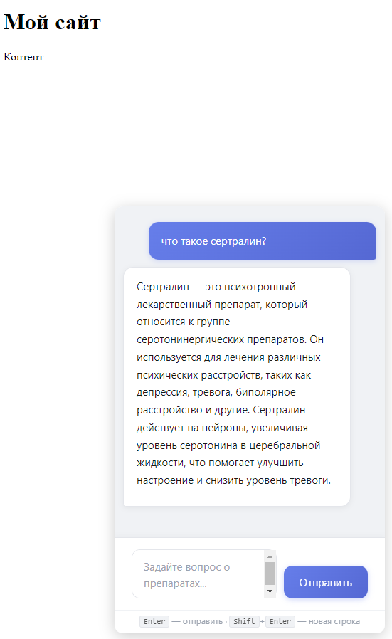
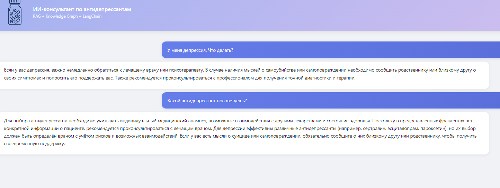
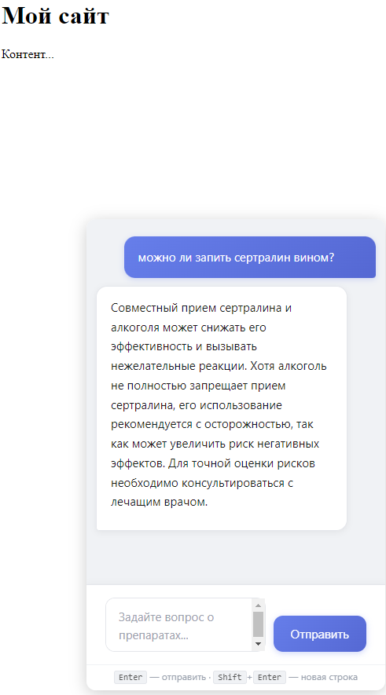
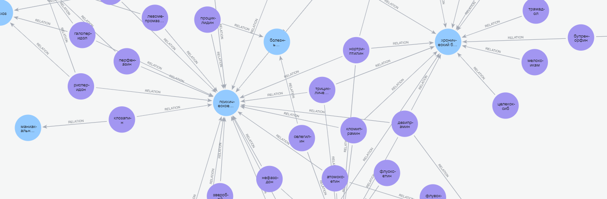
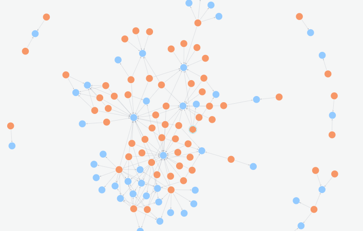
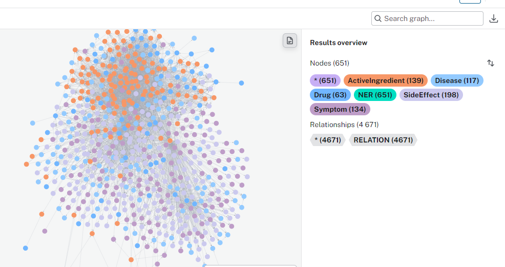
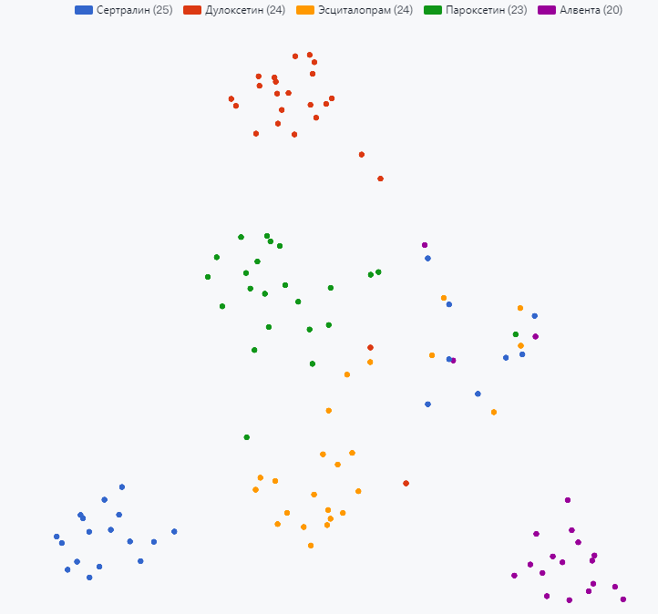
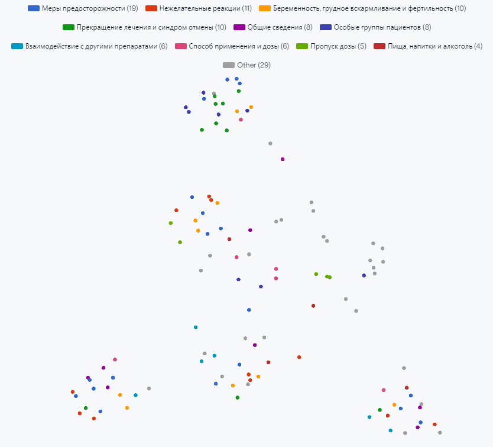

# Drug LLM — RAG Assistant for Antidepressants

A **local LLM chat with a hybrid RAG system** designed for **trustworthy, grounded
medical answers**. Instead of relying on the model's memory, every response is built
from **retrieved evidence** — vector fragments of official drug leaflets (**Qdrant**)
combined with a structured knowledge graph of "drug — ingredient — effect" relations
(**Neo4j**). This makes the assistant **careful with medical information**:
it does not invent facts, cites its sources, and explicitly says when something
is not in the retrieved context.

The LLM itself runs locally via **Ollama** — **any model supported by Ollama** can
be used, from compact `qwen3:1.7b` for low-end hardware to `qwen2.5:7b-instruct`
or larger for higher quality. The active model is selected via `MODEL` and
`MODEL_NER` in `.env`, no code changes required.

Streaming WebSocket chat built on **FastAPI** and **LangChain**, fully containerized,
with automatic database bootstrap from Hugging Face. The answer **streams smoothly
token by token** — the reply starts appearing immediately instead of waiting for the
whole generation to finish, so the chat feels responsive even on CPU-only hardware.

> ⚠️ **Important:** This assistant is **not a substitute for a doctor**. For severe
> depression or suicidal thoughts, the assistant **always redirects to professional
> medical help**. If you are in crisis, contact emergency services immediately.

---

> 💚 **Encouraged:** This project is meant for **public benefit** and to **help people
> living with depression**. You are welcome to deploy it widely on specialized
> health-related resources, patient support platforms, and mental health communities —
> anywhere it can make medical information more accessible and reduce harm.

---

## Tech stack

| Layer | Technology | Role |
|---|---|---|
| **LLM** | [Ollama](https://ollama.com) | runs the local model; no data leaves your machine |
| **LLM** | [LangChain](https://python.langchain.com) | prompt templates, streaming, dialogue memory |
| **RAG** | [Qdrant](https://qdrant.tech) | vector search over drug leaflet fragments (embeddings) |
| **RAG** | [Neo4j](https://neo4j.com) | knowledge graph of "drug — ingredient — effect" relations |
| **Backend** | [FastAPI](https://fastapi.tiangolo.com) | HTTP/WebSocket API, UI routing, token streaming to the browser |
| **Embeddings** | `intfloat/multilingual-e5-large` | multilingual embeddings shared by indexing and queries |

Python 3.12 · Docker Compose · Jinja2 templates · vanilla JS frontend.

---

## Two interfaces

| Interface | URL | Purpose |
|---|---|---|
| **Standalone chat** | `http://YOUR_DOMAIN:8000/ui_lc` | full-page chat with dialogue memory, Markdown rendering, streaming |
| **Widget chat-bot** | `http://YOUR_DOMAIN:8000/widget` | compact embeddable version for third-party websites via `<iframe>` |

### Embed the widget on any website

```html
<iframe src="http://YOUR_DOMAIN:8000/widget"
        style="position: fixed; right: 20px; bottom: 20px;
               width: 380px; height: 600px; border: none;
               border-radius: 12px; box-shadow: 0 4px 20px rgba(0,0,0,0.15);">
</iframe>
```

<details>
<summary>Screenshots</summary>

### Chat — variants





### Graph — variants





### Vector search




</details>

---

## Architecture

| Service | Port (localhost only) | Purpose |
|---|---|---|
| `storage-init` | — | one-off download of the databases (~740 MB) from Hugging Face into `./storage` |
| `qdrant` | 6333 / 6334 | vector database with leaflet fragments |
| `neo4j` | 7474 / 7687 | knowledge graph |
| `app` | 8000 | FastAPI + UI, talks to Ollama on the host |

```
browser → app:8000 → Qdrant (chunks)
                   → Neo4j (relations)
                   → Ollama on the host (answer generation)
```

---

## Requirements

- Docker Engine 24+ / Docker Desktop with Compose v2
- **Ollama on the host** (not in Docker): <https://ollama.com/download>
- RAM: 8 GB minimum, 16 GB recommended (7B model + embeddings)
- Disk: ~6 GB (databases 0.8 GB + models ~4 GB)
- Free ports: 8000, 6333, 6334, 7474, 7687

---

## Quick start

### 1. Clone the repository

```bash
git clone https://github.com/OlegChausov/Drug_LLM.git
cd Drug_LLM
```

### 2. Prepare Ollama

```bash
ollama pull qwen2.5:7b-instruct
```

Allow access from the container (**required**, otherwise the app cannot reach the LLM):

```bash
# Linux
sudo systemctl edit ollama
# in the file that opens:
[Service]
Environment="OLLAMA_HOST=0.0.0.0:11434"
sudo systemctl restart ollama

# Windows (PowerShell, then restart Ollama from the tray)
setx OLLAMA_HOST 0.0.0.0:11434
```

Check: `curl http://localhost:11434/api/tags`

### 3. Create `.env`

```bash
cp .env.example .env      # Windows: copy .env.example .env
```

Make sure to check:

- `NEO4J_PASSWORD` — at least 8 characters, Latin letters/digits/`_` only (no `$`, quotes, spaces).
  The password is applied to the downloaded database on first start.
- `MODEL` / `MODEL_NER` — the models you pulled into Ollama.
- `HF_TOKEN` — may be left empty for the public dataset.

The file must be encoded as **UTF-8 without BOM** with **LF** line endings
(if you edited it in Notepad and saved as CRLF, a `\r` will end up in the password).

### 4. Run

```bash
docker compose up -d --build
```

The first image build takes 5–10 minutes (CPU torch + dependencies), the first data download
takes another 1–5 minutes. Track progress: `docker compose logs -f storage-init`

### 5. Open

- Chat: <http://127.0.0.1:8000/ui_lc>
- Widget: <http://127.0.0.1:8000/widget>

The first request additionally downloads the embedding model (~2 GB) — this is expected and is
cached in the `hf_cache` volume.

---

## `.env` variables

| Variable | Default | Purpose |
|---|---|---|
| `OLLAMA_BASE_URL` | `http://127.0.0.1:11434` | Ollama address (replaced with `host.docker.internal` in compose) |
| `MODEL` | `qwen2.5:7b-instruct` | model used for answers |
| `MODEL_NER` | `qwen2.5:7b-instruct` | model used for entity extraction |
| `QDRANT_URL` | `http://127.0.0.1:6333` | in compose → `http://qdrant:6333` |
| `QDRANT_COLLECTION` | `drugs` | collection name |
| `QDRANT_VERSION` | `v1.19.1` | Qdrant image tag; must match the data format on HF |
| `QDRANT_HTTP_PORT` / `QDRANT_GRPC_PORT` | `6333` / `6334` | published ports |
| `NEO4J_URI` | `bolt://127.0.0.1:7687` | in compose → `bolt://neo4j:7687` |
| `NEO4J_USER` / `NEO4J_PASSWORD` | `neo4j` / `neo4j_for_drugs` | Neo4j credentials |
| `NEO4J_VERSION` | `2026.09.0` | Neo4j image tag; must match the data format on HF |
| `NEO4J_HTTP_PORT` / `NEO4J_BOLT_PORT` | `7474` / `7687` | published ports |
| `NEO4J_HEAP_INITIAL` / `NEO4J_HEAP_MAX` / `NEO4J_PAGECACHE` | `512m` / `1G` / `512m` | Neo4j memory |
| `EMBED_MODEL_NAME` | `intfloat/multilingual-e5-large` | embedding model |
| `TOP_K_CHUNKS` | `3` | how many fragments to fetch from Qdrant |
| `MAX_GRAPH_EDGES` | `40` | how many relations to fetch from Neo4j |
| `HF_TOKEN` | empty | HF token (rate limit / private repository) |
| `HF_REPO_ID` | `OlegChausov/drug-llm-storage` | dataset with the databases |

---

## Maintenance

### Re-download the databases from Hugging Face

```bash
docker compose down
docker compose run --rm storage-init   # or: delete storage/.ready and start again
docker compose up -d
```

`storage-init` skips the download when `storage/.ready` exists. Removing that file forces a full
re-download of `./storage` (local changes to the databases will be lost).

### Change the Neo4j password after the first start

```bash
docker compose exec neo4j cypher-shell -u neo4j -p 'old_password' \
  "ALTER CURRENT USER SET PASSWORD FROM 'old_password' TO 'new_password'"
```

Then update `NEO4J_PASSWORD` in `.env` and run `docker compose up -d app`.

### Logs

```bash
docker compose logs -f app
docker compose logs -f storage-init
docker compose logs -f neo4j
```

### Full shutdown

```bash
docker compose down          # data in ./storage is kept
docker volume rm drug_llm_hf_cache   # optional: remove the model cache
```

---

## Troubleshooting

| Symptom | Cause / fix |
|---|---|
| `env file .env not found` | `.env` was not created — run `cp .env.example .env` |
| `NEO4J_PASSWORD must be set in .env` | password is empty/missing in `.env` |
| `storage-init` exited with an error | no internet or HF rate limit — set `HF_TOKEN`, then `docker compose run --rm storage-init` |
| `app` does not start, `qdrant` is unhealthy | check `docker compose logs qdrant`; the image version must match `QDRANT_VERSION` |
| `app` does not start, `neo4j` is unhealthy | wrong password or Neo4j version older than the data format — see `NEO4J_VERSION` |
| Empty answers, `Connection refused` to `11434` in logs | Ollama is not listening on `0.0.0.0` — see step 2 |
| `model not found` | `ollama pull` was not run for the model in `MODEL` / `MODEL_NER` |
| Slow first answer | the embedding model (~2 GB) is being downloaded into the `hf_cache` volume |
| Port already in use | change `QDRANT_HTTP_PORT`, `NEO4J_HTTP_PORT`, etc. in `.env` |

---

## Project structure

```
LLM_app/
  main.py          # FastAPI, router and static mounting
  chain_lc.py      # LangChain pipeline with dialogue memory
  rag.py           # Qdrant + Neo4j + context assembly
  ner.py           # entity extraction via Ollama
  routers/         # WebSocket and UI routers
  templates/       # HTML templates
static/            # CSS/JS/logo
Dockerfile         # application image
docker-compose.yml # storage-init + qdrant + neo4j + app
requirements.txt   # Python dependencies
storage/           # databases (downloaded automatically, not tracked in git)
```

---

## Running without Docker (development)

```bash
python -m venv .venv
.venv\Scripts\activate            # Linux/macOS: source .venv/bin/activate
pip install -r requirements.txt
uvicorn LLM_app.main:app --reload --port 8000
```

Qdrant and Neo4j must be running (e.g. `docker compose up -d qdrant neo4j`), and
`QDRANT_URL` / `NEO4J_URI` in `.env` must point to `127.0.0.1`.
